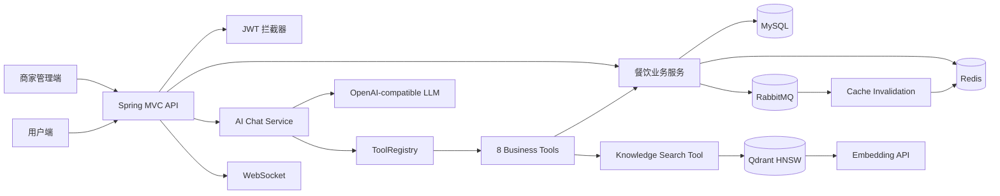

# Merchant AI Operations Platform

> 商家智能运营系统：面向前台点餐与商家运营的 B/S 架构后端，在传统餐饮业务之上集成 LLM Function Calling、SSE 流式响应、工具注册中心、安全二次确认、RabbitMQ 缓存失效，以及基于 Qdrant 的门店 SOP/平台政策 RAG。

[](https://github.com/walawala88/merchant-ai-operations/actions/workflows/ci.yml)
[](https://openjdk.org/projects/jdk/17/)
[](https://spring.io/projects/spring-boot)
[](LICENSE)

## 项目简介

项目包含用户端点餐、商家运营管理、订单流转、经营报表和 AI 智能运营助手。核心目标不是简单调用大模型，而是让 LLM 通过受控工具访问真实业务数据，并由 Java 后端约束修改型操作，保证回答有数据依据、写操作必须经过用户确认。

AI 助手采用 OpenAI 兼容的 `chat/completions` 协议，通过 Function Calling 调用 8 个业务工具，支持多轮工具编排；最终回答通过 SSE 增量推送。菜品起售、停售属于修改型操作，首次调用只返回预览与一次性确认令牌，用户确认后由后端校验令牌并执行。

知识问答采用 Qdrant 向量库：门店 SOP 和平台政策经过切片、Embedding 后建立索引，通过 HNSW ANN 检索、Top-K、tenant/store/docType 元数据过滤和应用层重排返回带来源的知识片段。

项目定位为求职展示与工程实践，不宣称达到生产环境标准。已实现知识库的租户、门店和文档类型过滤；生产化仍需补充文档权限校验、会话持久化、全链路可观测性、内容安全和真实业务文档评测。

## 核心能力

### 餐饮业务

- 员工登录、员工管理与账号启停
- 菜品、套餐、分类的增删改查与起售/停售
- 用户端浏览、购物车、地址簿、下单与支付
- 商家接单、拒单、派送、完成、取消与订单状态统计
- 营业额、订单、用户、销量 Top10 报表与 Excel 导出
- 店铺营业状态管理
- WebSocket 来单提醒与订单状态通知
- 定时处理超时未支付、派送超时订单

### AI 智能运营助手

- OpenAI 兼容 LLM 客户端，支持智谱 GLM 等服务
- 8 个 Function Calling 工具，统一复用现有 Service 层
- Qdrant HNSW ANN 向量检索，支持 Top-K 和文档切片
- `tenantId`、`storeId`、`docType`、状态和生效日期元数据过滤
- 全局平台政策与门店 SOP 的 scope 隔离
- 向量相似度 + 中文 bigram 词法重叠的应用层重排
- 知识回答返回文档标题、版本、生效日期和来源
- `ToolRegistry` 自动收集工具并生成 JSON Schema Tool Definition
- 最多 5 轮工具调用，防止编排死循环
- SSE 流式返回 `start`、`thinking`、`tool`、`tool_result`、`message`、`done`、`error` 事件
- 修改型工具采用 UUID 一次性确认令牌，LLM 无法自行确认
- 会话历史按 `sessionId` 隔离，自动裁剪到最近 40 条消息

### 缓存与可靠性

- Redis 缓存菜品、套餐与店铺营业状态
- RabbitMQ 发布缓存失效事件
- 事务提交后再发送消息，避免脏缓存
- 消费失败自动重试 3 次并进入死信队列
- Broker 不可用时自动降级为本地缓存失效
- JWT 双通道拦截：管理端 `/admin/**` 与用户端 `/user/**`

## 系统架构



## 技术栈

| 分类 | 技术 |
| --- | --- |
| 语言与构建 | Java 17、Maven 多模块 |
| Web | Spring Boot 2.7、Spring MVC、Spring AOP |
| 数据访问 | MyBatis、PageHelper、MySQL 8、Druid |
| 缓存与消息 | Redis、Spring Cache、RabbitMQ |
| RAG | Qdrant、HNSW ANN、Embedding、Top-K、元数据过滤、重排 |
| 鉴权与实时通信 | JWT、自定义拦截器、WebSocket |
| AI | OpenAI-compatible API、Function Calling、JSON Schema、SSE |
| 接口文档 | Knife4j / Swagger 2 |
| 文件与支付 | 阿里云 OSS、微信支付 v3 API（可选配置） |
| 报表 | Apache POI |
| 测试与工程化 | JUnit 5、Mockito、Docker Compose、GitHub Actions |

## AI 工具

| 工具 | 类型 | 说明 |
| --- | --- | --- |
| `getBusinessData` | 只读 | 查询营业额、有效订单、完成率、客单价、新增用户 |
| `getOrderStatistics` | 只读 | 查询区间订单量与完成率 |
| `getTopSellingDishes` | 只读 | 查询销量 Top10 |
| `getTodayTurnover` | 只读 | 查询今日营业额 |
| `getDishInfo` | 只读 | 查询菜品及口味信息 |
| `searchKnowledge` | 只读 | 检索门店 SOP 与平台政策，返回带来源的知识片段 |
| `startDish` | 修改 | 菜品起售，需要一次性确认令牌 |
| `stopDish` | 修改 | 菜品停售，需要一次性确认令牌 |

## 知识库 RAG

知识库只覆盖两类内容：门店 SOP 和平台规则政策。

```text
文档 API
  -> 文档切片
  -> Embedding
  -> Qdrant 向量入库

用户问题
  -> tenant/store/docType/生效日期过滤
  -> HNSW ANN Top-K
  -> 向量分数 + 中文 bigram 词法重排
  -> 返回标题、版本、生效日期、来源和正文片段
```

接口：

- `POST /admin/knowledge/documents`：导入或更新文档
- `POST /admin/knowledge/search`：检索知识片段

示例文档位于 [`docs/rag`](docs/rag/README.md)。

## AI 对话链路

```text
POST /admin/ai/chat/stream
  -> JWT 管理端拦截
  -> 读取或创建 session messages
  -> 注入 system prompt 与 Tool Definition
  -> LLM 返回 tool_calls
  -> ToolRegistry 查找并执行工具
  -> 工具结果以 role=tool 回传给 LLM
  -> 最多 5 轮
  -> 通过 SSE 分批推送最终回答
```

修改型工具安全链路：

```text
用户：停售宫保鸡丁
  -> LLM 首次调用 stopDish（无 token）
  -> 后端只返回预览 + UUID 确认令牌
  -> 用户明确回复“确认”
  -> LLM 再调用 stopDish（携带 token）
  -> PendingConfirmationStore 校验并消费 token
  -> Java 执行 DishService.startOrStop
```

## 快速开始

### 环境要求

- JDK 17
- Maven 3.6+
- Docker Desktop 或 Docker Engine（推荐）

### 1. 配置环境变量

```bash
cp .env.example .env
```

Windows PowerShell：

```powershell
Copy-Item .env.example .env
```

开发环境默认账号：

- 用户名：`admin`
- 密码：`Merchant@123`

> 该账号仅用于本地开发，部署前必须修改。

### 2. 启动基础设施

```bash
docker compose up -d
```

Compose 会启动：

- MySQL 8，自动导入 `merchant_ops.sql`
- Redis 7，开启 AOF 与密码保护
- RabbitMQ 3.13 Management
- RabbitMQ 管理台：`http://localhost:15672`

### 3. 构建并启动应用

```bash
mvn clean package
java -jar merchant-server/target/merchant-server-1.0.0.jar
```

启动后访问：

- 应用：`http://localhost:8080`
- Knife4j 文档：`http://localhost:8080/doc.html`
- WebSocket：`ws://localhost:8080/ws/{sid}`

### 4. 启用 AI 助手

至少配置以下变量：

```bash
AI_API_KEY=your-api-key
AI_BASE_URL=https://open.bigmodel.cn/api/paas/v4
AI_MODEL=glm-4-flash
```

调用示例：

```bash
curl -N -X POST "http://localhost:8080/admin/ai/chat/stream" \
  -H "Content-Type: application/json" \
  -H "token: <admin-jwt>" \
  -d '{"message":"退款规则是什么","sessionId":"demo","tenantId":"tenant-demo","storeId":"store-1"}'
```

当前前端 AI 请求会携带 `tenantId` 和 `storeId`，本地未配置时 `tenantId` 默认为 `default`。\n\n### 5. 启用 Qdrant RAG

```bash
docker compose up -d qdrant
```

同时配置 OpenAI 兼容的 Embedding 接口：

```bash
AI_EMBEDDING_MODEL=embedding-3
AI_EMBEDDING_DIMENSION=1024
```

### 6. 启用 RabbitMQ 缓存失效

```bash
RABBITMQ_ENABLED=true
```

未启用或 Broker 调用失败时，系统会回退到本地缓存失效逻辑。

## 环境变量

| 变量 | 默认值 | 说明 |
| --- | --- | --- |
| `SERVER_PORT` | `8080` | 应用端口 |
| `DB_URL` | `jdbc:mysql://127.0.0.1:3306/merchant_ops?...` | MySQL 连接串 |
| `DB_USERNAME` | `root` | MySQL 用户名 |
| `DB_PASSWORD` | `merchant_dev` | MySQL 密码 |
| `REDIS_HOST` | `127.0.0.1` | Redis 地址 |
| `REDIS_PORT` | `6379` | Redis 端口 |
| `REDIS_PASSWORD` | `merchant_dev` | Redis 密码 |
| `REDIS_DATABASE` | `10` | Redis 数据库编号 |
| `RABBITMQ_ENABLED` | `false` | 是否启用 RabbitMQ 缓存失效 |
| `JWT_ADMIN_SECRET` | 开发占位值 | 管理端 JWT 密钥 |
| `JWT_USER_SECRET` | 开发占位值 | 用户端 JWT 密钥 |
| `AI_BASE_URL` | 智谱兼容地址 | LLM 基础地址 |
| `AI_API_KEY` | 空 | LLM API Key |
| `AI_MODEL` | `glm-4-flash` | 对话模型名称 |
| `AI_EMBEDDING_MODEL` | `embedding-3` | Embedding 模型名称 |
| `AI_EMBEDDING_DIMENSION` | `1024` | 向量维度，必须与模型一致 |
| `QDRANT_URL` | `http://127.0.0.1:6333` | Qdrant HTTP 地址 |
| `QDRANT_COLLECTION` | `merchant_knowledge` | 知识库 collection |
| `RAG_TOP_K` | `12` | ANN 初始召回数量 |
| `RAG_FINAL_TOP_K` | `5` | 重排后返回数量 |
| `RAG_MIN_SCORE` | `0.2` | 最低向量分数 |
| `RAG_CHUNK_SIZE` | `500` | 文档切片最大字符数 |
| `RAG_CHUNK_OVERLAP` | `80` | 切片重叠字符数 |
| `ALIYUN_OSS_*` | 空 | OSS 接入参数 |
| `WECHAT_*` | 空 | 微信登录与支付参数 |

完整变量见 [.env.example](.env.example)。

## 接口概览

### 管理端

| 方法 | 路径 | 说明 |
| --- | --- | --- |
| `POST` | `/admin/employee/login` | 员工登录并签发 JWT |
| `GET` | `/admin/report/turnoverStatistics` | 营业额统计 |
| `GET` | `/admin/report/ordersStatistics` | 订单统计 |
| `GET` | `/admin/report/top10` | 销量 Top10 |
| `GET` | `/admin/report/export` | 导出运营报表 |
| `GET` | `/admin/workspace/businessData` | 工作台经营数据 |
| `POST` | `/admin/ai/chat/stream` | AI SSE 对话 |
| `POST` | `/admin/knowledge/documents` | 导入或更新 SOP/政策文档 |
| `POST` | `/admin/knowledge/search` | 检索 SOP/政策知识 |

管理端请求头：

```http
token: <admin-jwt>
```

### 用户端

| 方法 | 路径 | 说明 |
| --- | --- | --- |
| `POST` | `/user/user/login` | 微信小程序登录 |
| `GET` | `/user/shop/status` | 查询店铺营业状态 |
| `POST` | `/user/shoppingCart/add` | 添加购物车 |
| `POST` | `/user/order/submit` | 提交订单 |
| `POST` | `/user/order/payment` | 发起支付 |

用户端请求头：

```http
authentication: <user-jwt>
```

## 项目结构

```text
merchant-ai-operations
├── .github/                         # CI、Issue 与 PR 模板
├── docs/                            # AI Agent 设计文档
├── merchant-common                  # 通用工具、异常、JWT、OSS、支付工具
├── merchant-pojo                    # Entity、DTO、VO
├── merchant-server                  # Controller、Service、Mapper、AI、MQ、WebSocket
│   ├── src/main/java/com/merchant/ops
│   │   ├── ai/                      # Function Calling、SSE 与知识库 RAG
│   │   ├── controller/admin         # 管理端接口
│   │   ├── controller/user          # 用户端接口
│   │   ├── interceptor              # JWT 拦截器
│   │   ├── mq                       # RabbitMQ 缓存失效
│   │   └── websocket                # 实时订单通知
│   └── src/main/resources
├── docker-compose.yml
├── merchant_ops.sql
└── pom.xml
```

## 测试与 CI

```bash
mvn clean verify
```

当前单元测试覆盖：

- JWT 签发与解析
- AI 提示词构建与经营分析意图识别
- 工具注册与 Tool Definition 生成
- 二次确认令牌一次性消费与操作匹配

GitHub Actions 在 Push 和 Pull Request 时执行 Java 17 构建与测试。

## 安全说明

- 仓库不包含数据库、Redis、OSS、微信或 LLM 真实凭据。
- 所有外部凭据通过环境变量注入。
- 修改型 AI 工具必须获得后端签发的一次性确认令牌。
- 日志不记录 JWT 原文或 OSS Secret。
- 生产环境应使用 HTTPS、独立密钥管理服务、强密码和最小权限账号。

如果旧版本曾提交过真实凭据，仅从当前文件删除并不安全，应立即在对应平台轮换或作废。

## RAG 验证边界

- 当前完成了 Qdrant REST 客户端、ANN/Top-K/元数据过滤/重排和 Agent 工具接入，并通过 Java 编译与单元测试。
- 当前环境没有 Qdrant 服务和 Embedding API Key，因此 RAG 端到端入库与检索尚未完成真实环境验证。
- 生产环境应根据实际 Embedding 模型设置 AI_EMBEDDING_DIMENSION，并补充文档版本、权限和评测集。

## 后续规划

- 将会话历史从进程内 Map 迁移到 Redis
- 为 AI 工具增加操作审计、幂等键和细粒度权限
- 将管理端密码哈希从 MD5 升级为 BCrypt/Argon2
- 增加 Prometheus、Micrometer 和结构化日志
- 增加 Testcontainers 集成测试
- 增加知识库文档版本管理、权限校验和 RAG 评测集

## 贡献

请阅读 [CONTRIBUTING.md](CONTRIBUTING.md)。安全问题请按 [SECURITY.md](SECURITY.md) 私下报告。

## License

本项目采用 [MIT License](LICENSE)。

